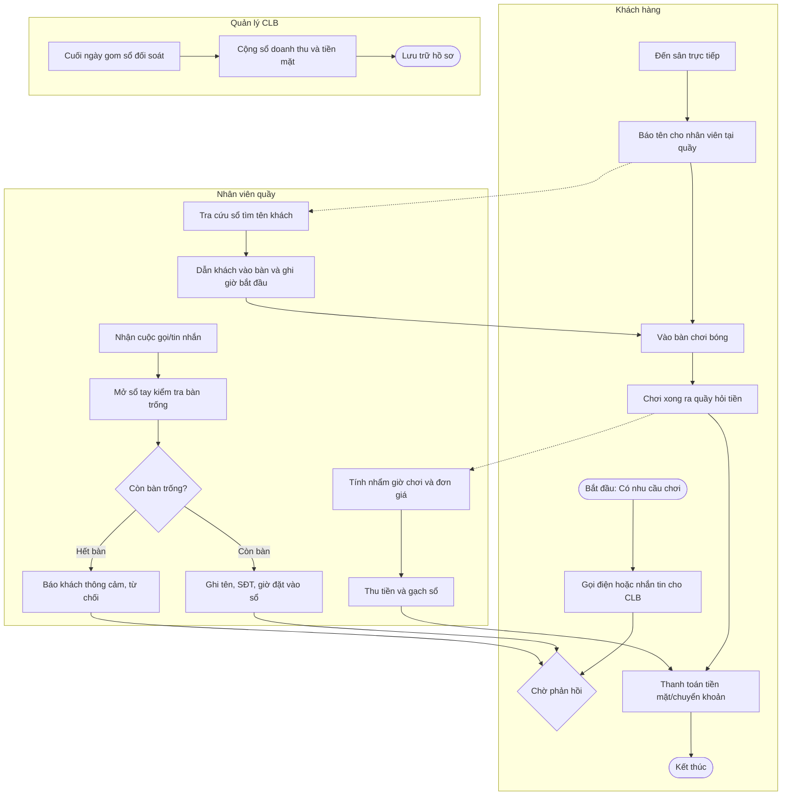
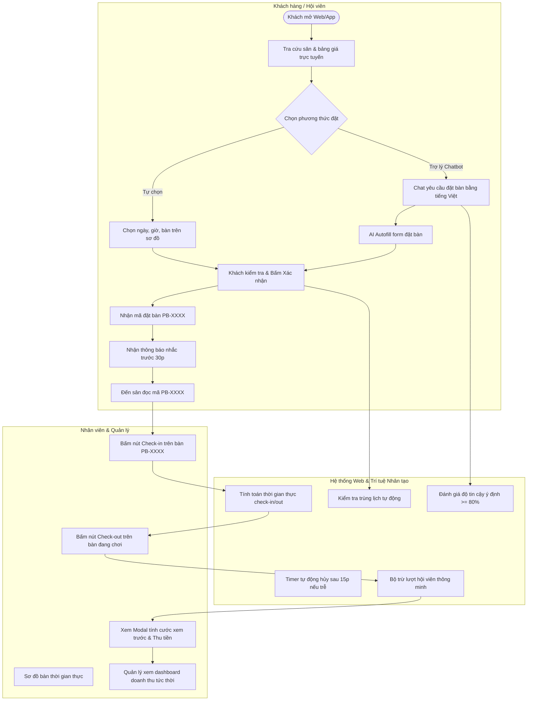

# BÁO CÁO DỰ ÁN MÔN HỌC: TỰ ĐỘNG HÓA QUY TRÌNH (MIS3047) - HỌC KỲ TP3.2
## ĐỀ TÀI: THIẾT KẾ VÀ XÂY DỰNG HỆ THỐNG TỰ ĐỘNG HÓA QUY TRÌNH ĐẶT BÀN VÀ QUẢN LÝ VẬN HÀNH SÂN BÓNG BÀN THÔNG MINH PINGPONGBROS TÍCH HỢP AI

**Lớp học phần**: 50K14.1  
**Nhóm thực hiện**: Nhóm 2  
**Đơn vị đào tạo**: Khoa Tin học Kinh tế - Trường Đại học Kinh tế, ĐH Đà Nẵng (DUE)

---

## MỤC LỤC BÁO CÁO
- [CHƯƠNG 1. GIỚI THIỆU BÀI TOÁN NGHIỆP VỤ](#chương-1-giới-thiệu-bài-toán-nghiệp-vụ)
  - [1.1. Tên quy trình nghiệp vụ và lý do lựa chọn](#11-tên-quy-trình-nghiệp-vụ-và-lý-do-lựa-chọn)
  - [1.2. Bối cảnh tổ chức và các vai trò tham gia](#12-bối-cảnh-tổ-chức-và-các-vai-trò-tham-gia)
  - [1.3. Các điểm nghẽn nghiệp vụ và số liệu ước lượng](#13-các-điểm-nghẽn-nghiệp-vụ-và-số-liệu-ước-lượng)
  - [1.4. Mục tiêu và phạm vi ứng dụng](#14-mục-tiêu-và-phạm-vi-ứng-dụng)
  - [1.5. Tóm tắt sản phẩm đầu ra](#15-tóm-tắt-sản-phẩm-đầu-ra)
- [CHƯƠNG 2. MÔ HÌNH HÓA QUY TRÌNH NGHIỆP VỤ](#chương-2-mô-hình-hóa-quy-trình-nghiệp-vụ)
  - [2.1. Mô hình As-Is](#21-mô-hình-as-is)
  - [2.2. Phân tích định lượng với BIMP](#22-phân-tích-định-lượng-với-bimp)
  - [2.3. Xử lý ngoại lệ trong quy trình](#23-xử-lý-ngoại-lệ-trong-quy-trình)
  - [2.4. Mô hình To-Be và các can thiệp cải tiến](#24-mô-hình-to-be-và-các-can-thiệp-cải-tiến)
- [CHƯƠNG 3. THIẾT KẾ TỰ ĐỘNG HÓA VÀ HỆ THỐNG PHẦN MỀM](#chương-3-thiết-kế-tự-động-hóa-và-hệ-thống-phần-mềm)
  - [3.1. Bản đồ AI trên quy trình nghiệp vụ](#31-bản-đồ-ai-trên-quy-trình-nghiệp-vụ)
  - [3.2. Thiết kế ngưỡng độ tin cậy (Threshold Design)](#32-thiết-kế-ngưỡng-độ-tin-cậy-threshold-design)
  - [3.3. Thiết kế phần mềm (Khung IDEA: Design)](#33-thiết-kế-phần-mềm-khung-idea-design)
- [CHƯƠNG 4. XÂY DỰNG, KIỂM THỬ VÀ ĐÁNH GIÁ HỆ THỐNG](#chương-4-xây-dựng-kiểm-thử-và-đánh-giá-hệ-thống)
  - [4.1. Đánh giá ứng dụng web theo 6 yêu cầu kỹ thuật tối thiểu](#41-đánh-giá-ứng-dụng-web-theo-6-yêu-cầu-kỹ-thuật-tối-thiểu)
  - [4.2. Nhật ký làm việc với AI (10 phiên tương tác tiêu biểu)](#42-nhật-ký-làm-việc-với-ai-10-phiên-tương-tác-tiêu-biểu)
  - [4.3. Kiểm thử chức năng và an toàn bảo mật](#43-kiểm-thử-chức-năng-và-an-toàn-bảo-mật)
  - [4.4. Đánh giá hiệu quả cải tiến (So sánh As-Is vs To-Be)](#44-đánh-giá-hiệu-quả-cải-tiến-so-sánh-as-is-vs-to-be)
  - [4.5. Kết luận và bài học kinh nghiệm](#45-kết-luận-và-bài-học-kinh-nghiệm)

---

## CHƯƠNG 1. GIỚI THIỆU BÀI TOÁN NGHIỆP VỤ

### 1.1. Tên quy trình nghiệp vụ và lý do lựa chọn
- **Tên quy trình**: *Quy trình Đặt bàn, Check-in/Check-out Tính cước và Quản lý Hội viên sân bóng bàn PingPongBros*.
- **Lý do lựa chọn**:
  - Phong trào rèn luyện thể thao bóng bàn ngày càng gia tăng, các câu lạc bộ (CLB) bóng bàn có quy mô từ 10 đến 20 bàn thường xuyên đối mặt với tình trạng quá tải vào khung giờ cao điểm (17:00 – 21:00).
  - Qua khảo sát thực tế tại CLB Bóng bàn PingPongBros, việc quản lý bàn hiện tại chủ yếu thông qua gọi điện thoại, tin nhắn mạng xã hội và ghi chép sổ tay hoặc file Excel rời rạc. Điều này dẫn đến tình trạng trùng lịch đặt bàn, nhầm lẫn ca dạy học của huấn luyện viên, thất thoát doanh thu khi khách chơi quá giờ, và thời gian chờ đợi thanh toán tại quầy kéo dài gây ức chế cho người chơi.
  - Việc tự động hóa quy trình nghiệp vụ kết hợp trí tuệ nhân tạo (AI) hỗ trợ đặt bàn thông minh và phân quyền nghiêm ngặt là yêu cầu cấp thiết để tối ưu hóa hiệu suất khai thác sân và nâng cao năng lực phục vụ.

### 1.2. Bối cảnh tổ chức và các vai trò tham gia
- **Đặc điểm cơ sở vật chất**:
  - Quy mô sân: **16 bàn tiêu chuẩn**, bố trí thành 4 dãy.
  - Phân vùng chức năng:
    - **Dãy 1 (Bàn 1 – 4)**: Khu vực dạy học chuyên dụng dành cho Giáo viên/Huấn luyện viên tổ chức lớp đào tạo (hoạt động từ 06:00 đến 19:00). Sau 19:00, các bàn trống sẽ được tự động giải phóng để phục vụ khách chơi tự do.
    - **Dãy 2, 3, 4 (Bàn 5 – 16)**: Khu vực sân chơi dành cho khách vãng lai và hội viên tháng.
  - Giờ mở cửa hoạt động: **06:00 – 21:00** hàng ngày.
- **Các vai trò (Actors) tham gia trong hệ thống**:
  1. **Khách vãng lai (`GUEST`)**: Người chơi lẻ theo giờ, đặt bàn linh hoạt theo từng khung giờ, trả tiền theo đơn giá giờ chơi thực tế.
  2. **Khách tháng / Hội viên (`MEMBER`)**: Khách hàng gắn bó lâu dài, mua các gói 1 tháng (30 lượt/30 ngày), 3 tháng (90 lượt/90 ngày), hoặc 6 tháng (180 lượt/180 ngày). Được quyền đặt sân khu học sau 19:00.
  3. **Giáo viên / Huấn luyện viên (`TEACHER`)**: Người phụ trách các lớp bóng bàn, gửi yêu cầu đăng ký phòng học (mỗi lớp 2 bàn), tự theo dõi tiến độ duyệt và check-out lớp học.
  4. **Nhân viên trực sân (`STAFF`)**: Phụ trách đón tiếp, thực hiện check-in khi khách đến sân, check-out kèm xem trước hóa đơn tính tiền, giải đáp các thắc mắc chuyển tiếp từ Chatbot.
  5. **Quản lý / Chủ CLB (`MANAGER`)**: Toàn quyền giám sát, phê duyệt/từ chối lớp học, cấp tài khoản nhân viên & hội viên, theo dõi báo cáo doanh thu đa chiều (ngày, tuần, tháng, quý, năm) và xử lý khiếu nại chuyển tiếp cấp cao.

### 1.3. Các điểm nghẽn nghiệp vụ và số liệu ước lượng
Dựa trên khảo sát 250 lượt khách/tuần tại cơ sở trước khi áp dụng phần mềm:
1. **Điểm nghẽn tiếp nhận và ghi nhận đặt chỗ**:
   - Nhân viên phải nghe điện thoại/trả lời tin nhắn trong lúc đón khách tại quầy. Thời gian trung bình để tư vấn, kiểm tra lịch trống và chốt một lượt đặt bàn mất **6 – 10 phút**. Tỷ lệ trùng lịch đặt bàn chiếm **12% – 18%** vào các buổi tối cuối tuần.
2. **Điểm nghẽn kiểm soát thời lượng chơi và tính phụ thu**:
   - Nhân viên ghi nhớ giờ bắt đầu của khách bằng mắt hoặc giấy nhớ. Khi khách chơi quá giờ (overtime), nhân viên thường quên tính tiền hoặc tính sai, gây thất thoát ước tính khoảng **15% doanh thu giờ chơi ngoài giờ**.
3. **Điểm nghẽn quản lý gói hội viên và ca dạy học**:
   - Thẻ hội viên bấm lỗ bằng giấy dễ rách, thất lạc hoặc tranh cãi về số lượt đã sử dụng. Giáo viên mở lớp không có cơ chế báo trước khiến quản lý không nắm được số bàn thực tế còn lại cho khách chơi tự do.
4. **Điểm nghẽn đối soát doanh thu cuối ngày**:
   - Cuối ca trực, nhân viên mất từ **30 – 45 phút** cộng sổ tay, đếm tiền mặt và đối chiếu các khoản chuyển khoản ngân hàng, dễ sai lệch số liệu.

### 1.4. Mục tiêu và phạm vi ứng dụng
- **Mục tiêu**:
  - Giảm thời gian chu trình đặt bàn từ 8 phút xuống dưới 1 phút thông qua tự phục vụ trực tuyến và Trợ lý AI.
  - Tự động hóa 100% việc tính tiền check-in/check-out dựa trên thời gian thực tế, loại bỏ sai sót tính cước thủ công.
  - Thiết lập cơ chế kiểm soát bảo mật và phân quyền nghiêm ngặt (RBAC) với 5 vai trò riêng biệt.
  - Tích hợp Chatbot thông minh với ngưỡng độ tin cậy $\ge 80\%$, tự động leo thang (escalation) chuyển tiếp hội thoại cho nhân viên và quản lý khi không đủ độ tin cậy.
- **Phạm vi ứng dụng**:
  - *Hệ thống làm gì*: Quản lý danh mục bàn, tiếp nhận đặt bàn online, sơ đồ trạng thái bàn real-time, tính cước check-in/out, trừ lượt hội viên, đăng ký duyệt lớp học, báo cáo doanh thu đa chiều, AI hỗ trợ điền form và tư vấn.
  - *Hệ thống không làm gì*: Không tự động trừ tiền trong tài khoản ngân hàng của khách (hệ thống tính cước và hỗ trợ nhân viên đối soát tiền mặt/chuyển khoản tại quầy); Chatbot không tự ý ra quyết định thanh toán hay đặt chỗ thay khách hàng mà chỉ hỗ trợ autofill form.

### 1.5. Tóm tắt sản phẩm đầu ra
- **Mô hình quy trình BPMN**: Bao gồm mô hình As-Is, mô hình phân tích mô phỏng BIMP và mô hình To-Be tích hợp tự động hóa.
- **Ứng dụng web toàn diện (Fullstack Web Application)**:
  - Frontend: Single Page Application (SPA) phát triển bằng React, TypeScript, TailwindCSS.
  - Backend: RESTful API phát triển bằng Node.js, Express, TypeScript, kiến trúc Scrypt + JWT.
  - Cơ sở dữ liệu: Dual persistence với PostgreSQL (Prisma) và JSON file store tự động sao lưu.
- **Tài liệu đặc tả và kiểm thử**: Đặc tả chức năng, ma trận kiểm thử, nhật ký tương tác AI và checklist bảo mật.

---

## CHƯƠNG 2. MÔ HÌNH HÓA QUY TRÌNH NGHIỆP VỤ

### 2.1. Mô hình As-Is (Hiện trạng khi chưa có hệ thống)
Quy trình hiện trạng vận hành dựa trên sổ tay và liên lạc thủ công qua điện thoại/Zalo.

### 2.2. Phân tích định lượng với BIMP
Mô phỏng 100 quy trình đặt bàn và vận hành trong 1 tuần bằng công cụ BIMP cho thấy các chỉ số:

| Hoạt động (Activity) | Vai trò thực hiện | Thời gian xử lý trung bình (Processing Time) | Thời gian chờ trung bình (Waiting Time) | Tần suất nhánh (Probability) | Đánh giá |
| :--- | :--- | :--- | :--- | :--- | :--- |
| Tiếp nhận yêu cầu đặt bàn qua điện thoại | Nhân viên | 5 phút | 12 phút (chờ bắt máy) | 100% | Nút cổ chai số 1 |
| Tra cứu sổ tay tìm bàn trống | Nhân viên | 3 phút | 0 phút | 100% | Dễ sai sót |
| Ghi nhận thông tin đặt bàn vào sổ | Nhân viên | 2 phút | 0 phút | 82% (khi còn bàn) | Thao tác thủ công |
| Check-in và xếp bàn khi khách đến | Nhân viên | 4 phút | 7 phút (chờ tới lượt) | 100% | Ùn ứ quầy |
| Tính tiền check-out và phụ thu quá giờ | Nhân viên | 6 phút | 8 phút | 100% | Nút cổ chai số 2 |
| Đối soát và chốt sổ doanh thu cuối ngày | Quản lý | 45 phút | 0 phút | 1 lần/ngày | Nút cổ chai số 3 |

- **Thời gian chu trình kỳ vọng (Cycle Time)**: Trung bình **142 phút** (bao gồm cả thời gian chơi trung bình 100 phút và các khoảng thời gian chờ/xử lý nghiệp vụ 42 phút).
- **Số lần bàn giao công việc (Hand-offs)**: 7 lần giữa Khách hàng, Nhân viên và Quản lý.
- **Ba nút cổ chai lớn nhất**:
  1. *Tiếp nhận đặt bàn và tra cứu bàn trống*: Chiếm 52% tổng thời gian chờ trước khi chơi.
  2. *Check-out và tính cước thủ công*: Gây nghẽn tại quầy khi nhiều khách cùng ra về vào cuối ca.
  3. *Tổng hợp báo cáo cuối ngày*: Tốn nhiều thời gian của Quản lý, dễ sai lệch tiền mặt và chuyển khoản.

### 2.3. Xử lý ngoại lệ trong quy trình
Trong thiết kế To-Be, hệ thống bổ sung 3 cơ chế xử lý ngoại lệ chuẩn BPMN:
1. **Sự kiện hẹn giờ biên không ngắt (Non-interrupting Boundary Timer Event)**:
   - Hệ thống tự động gửi thông báo nhắc hẹn trước **30 phút** trước giờ khách đến sân qua Web Notification/SMS.
   - Khi bàn đang chơi sắp hết giờ (còn 5 phút), hệ thống gửi thông báo cho Nhân viên để chủ động nhắc khách chuẩn bị check-out.
2. **Sự kiện lỗi biên (Boundary Error Event - Trùng lịch / Xung đột bàn)**:
   - Khi khách hoặc giáo viên đặt trùng bàn hoặc giờ chơi đè lên lớp học đã duyệt, hệ thống kích hoạt ngoại lệ `BookingConflictError`.
   - Hệ thống tự động đề xuất các khung giờ thay thế lân cận (AI-1) hoặc chuyển hướng khách sang chế độ "Hàng đợi chờ bàn" (Waiting List).
3. **Sự kiện tiến trình con hủy đơn (Event Sub-process - Quá hạn 15 phút)**:
   - Nếu sau **15 phút** tính từ giờ bắt đầu ghi trên đơn đặt mà khách chưa đến làm thủ tục check-in, một tiến trình con tự động kích hoạt: Chuyển đơn sang trạng thái `EXPIRED`, giải phóng bàn về `AVAILABLE` và gửi thông báo mời người đầu tiên trong Hàng đợi chờ.

### 2.4. Mô hình To-Be và các can thiệp cải tiến
Quy trình To-Be tích hợp tự động hóa qua hệ thống phần mềm và AI:

**Bảng tổng hợp các can thiệp cải tiến trong To-Be**:
| Điểm cải tiến | Cơ chế As-Is | Giải pháp To-Be | Lợi ích mang lại |
| :--- | :--- | :--- | :--- |
| Đặt bàn | Gọi điện thoại, ghi sổ tay | Đặt trực tuyến 24/7 + Chatbot NLP | Giảm thời gian đặt từ 8 phút xuống < 30 giây |
| Kiểm soát lịch | Nhìn bằng mắt thường | Validation logic cấm đặt trùng tự động | Loại bỏ 100% tình trạng trùng bàn |
| Check-in | Tìm tên trong sổ giấy | Tìm nhanh mã `PB-XXXX`, 1 click check-in | Giảm thời gian chờ tại quầy từ 7p xuống 10 giây |
| Check-out tính cước | Nhân viên bấm máy tính nhẩm | Backend tính cước thời gian thực + Modal Preview | Không thất thoát doanh thu lố giờ, minh bạch |
| Quản lý Hội viên | Đóng dấu giấy, dễ mất | Lưu trữ số hóa, tự động trừ 1 hoặc 2 lượt | Quản lý lượt chơi chính xác, tự động báo gia hạn |
| Báo cáo doanh thu | Quản lý cộng sổ cuối ngày | Dashboard Real-time (ngày, tuần, tháng) | Tiết kiệm 45 phút/ngày cho quản lý |

---

## CHƯƠNG 3. THIẾT KẾ TỰ ĐỘNG HÓA VÀ HỆ THỐNG PHẦN MỀM

### 3.1. Bản đồ AI trên quy trình nghiệp vụ
Phân bổ các hoạt động trong quy trình To-Be theo 4 nhóm tự động hóa:

| Tên hoạt động trong To-Be | Phân nhóm tự động hóa | Mô tả chi tiết triển khai | Lý do lựa chọn | Mức rủi ro nếu sai |
| :--- | :--- | :--- | :--- | :--- |
| Kiểm tra trùng lịch và khóa bàn | **Tự động theo luật (Rule-based)** | Thuật toán SQL so khớp thời gian bắt đầu và kết thúc | Logic nghiệp vụ cố định, yêu cầu độ chính xác 100% | Rất cao (xung đột khách) |
| Trừ lượt chơi của Hội viên | **Tự động theo luật (Rule-based)** | Chơi $\le 2$h trừ 1 lượt, $> 2$h trừ 2 lượt | Quy định niêm yết rõ ràng, không phụ thuộc cảm tính | Cao (khiếu nại trừ sai lượt) |
| Gợi ý khung giờ thay thế (AI-1) | **Tự động có AI hỗ trợ** | Thuật toán phân tích khoảng trống lịch bàn lân cận | Cần linh hoạt gợi ý giờ phù hợp nhu cầu khách | Thấp (khách có thể từ chối) |
| Dự báo mật độ giờ cao điểm (AI-2) | **Tự động có AI hỗ trợ** | Phân tích hồi quy lịch sử đặt sân theo thứ trong tuần | Dữ liệu dao động liên tục, cần dự báo xu hướng | Thấp (chỉ để tham khảo ca trực) |
| Trích xuất thông tin đặt bàn (AI-3) | **Tự động có AI hỗ trợ** | Mô hình Regex NLP bóc tách ngày, giờ, người, thời lượng | Hỗ trợ nhập liệu tự nhiên, tăng tiện ích | Trung bình (khách vẫn kiểm tra lại) |
| Trả lời câu hỏi thường gặp qua Chatbot | **Giao cho Agent (Đạt ngưỡng $\ge 80\%$)** | Trợ lý Chatbot tự động trả lời giá, giờ, bàn trống | Giảm tải 80% câu hỏi lặp đi lặp lại của khách | Trung bình (đã chặn câu hỏi nội bộ) |
| Phê duyệt / Từ chối mở lớp dạy học | **Giữ thủ công (Human in the loop)** | Quản lý bắt buộc bấm nút và nhập lý do nếu từ chối | Trách nhiệm quản trị, liên quan đến chất lượng HLV | Rất cao nếu tự động hóa sai |
| Thu tiền mặt / Xác nhận nhận tiền tại quầy | **Giữ thủ công (Human in the loop)** | Nhân viên nhận tiền thực tế rồi mới bấm xác nhận | Đảm bảo an toàn tài chính, tránh thất thoát | Rất cao (thất thoát tiền tệ) |

### 3.2. Thiết kế ngưỡng độ tin cậy (Threshold Design)

#### a) Bài toán thiết kế ngưỡng cho Chatbot AI
Trong hệ thống PingPongBros, chức năng Chatbot tư vấn được thiết kế có **Ngưỡng độ tin cậy (Confidence Score)** nhằm quyết định:
- Khi độ tin cậy $\ge \theta^*$: Cho phép Chatbot tự động phản hồi khách hàng hoặc tự động trích xuất điền form.
- Khi độ tin cậy $< \theta^*$: Chặn Chatbot không được trả lời bừa, tự động chuyển tiếp (escalate) cuộc trò chuyện cho Nhân viên trực quầy (nếu nhân viên vắng mặt thì chuyển tiếp lên Quản lý).

#### b) Giả định chi phí và lập luận kinh tế
- Gọi $X$ là **chi phí xử lý thủ công** khi chuyển tiếp cho nhân viên con người: Bao gồm thời gian nhân viên đọc và trả lời tin nhắn (ước tính 3 phút công việc, tương đương $X = 10.000$ VNĐ).
- Gọi $Y$ là **thiệt hại khi AI quyết định sai**: Nếu Chatbot tự ý suy đoán sai thông tin (ví dụ: báo sai giờ mở cửa, báo sai giá sân, báo còn bàn nhưng thực tế hết bàn), khách hàng đến sân bị xung đột lịch, gây mất uy tín CLB và mất khách hàng tiềm năng. Thiệt hại ước tính $Y = 50.000$ VNĐ.
- Điều kiện kinh tế để quyết định giao cho AI tự động xử lý là kỳ vọng thiệt hại của việc AI trả lời phải nhỏ hơn chi phí xử lý thủ công:
$$\text{Expected Loss}(\text{AI}) \le \text{Expected Loss}(\text{Manual})$$
$$(1 - c) \cdot Y \le X$$
Trong đó $c$ là Độ tin cậy (Confidence Score) của câu trả lời.
Biến đổi công thức tìm ngưỡng tối ưu $\theta^*$:
$$1 - c \le \frac{X}{Y} \implies c \ge 1 - \frac{X}{Y} = 1 - \frac{10.000}{50.000} = 0.80$$

$$\implies \mathbf{\theta^* = 80\%}$$

#### c) Bảng ma trận quyết định ngưỡng
| Mức độ tin cậy ($c$) | Tình trạng dữ liệu | Hành động của Hệ thống | Người chịu trách nhiệm |
| :--- | :--- | :--- | :--- |
| **$c \ge 80\%$** | Khớp chính xác từ khóa & quyền hạn của vai trò | Chatbot tự động trả lời hoặc Autofill form | Chatbot AI |
| **$c < 80\%$** | Câu hỏi mập mờ, ngoài phạm vi, hoặc người dùng yêu cầu sâu | Tự động chuyển hội thoại cho Nhân viên trực sân | Nhân viên trực ca |
| Nhân viên không xử lý được | Câu hỏi phức tạp về chính sách, giá sỉ, khiếu nại | Bấm nút **"↗ Chuyển qua Quản lý"** | Quản lý CLB |

### 3.3. Thiết kế phần mềm (Khung IDEA: Design)

#### a) Mô hình dữ liệu (Data Model)
- **`User`**: `id`, `name`, `email`, `phone`, `password` (băm Scrypt), `role` (`GUEST` | `MEMBER` | `TEACHER` | `STAFF` | `MANAGER`), `mustChangePassword` (boolean), `createdAt`.
- **`Table`**: `id`, `name`, `type` (`STANDARD` | `VIP` | `TRAINING`), `status` (`AVAILABLE` | `BOOKED` | `IN_USE` | `MAINTENANCE`), `pricePerHour`.
- **`Booking`**: `id`, `code` (`PB-XXXX`), `userId`, `tableId`, `date`, `startTime`, `durationHours`, `endTime`, `numPlayers`, `status`, `actualCheckInTime`, `actualCheckOutTime`, `totalPrice`, `deductedTurns`.
- **`Class`**: `id`, `teacherId`, `title`, `tableIds` (mảng 2 bàn khu dạy), `date`, `startTime`, `endTime`, `status` (`PENDING` | `APPROVED` | `REJECTED`), `rejectionReason`.
- **`Membership`**: `id`, `userId`, `packageName` (1, 3, 6 tháng), `totalTurns`, `remainingTurns`, `startDate`, `endDate`, `status`.
- **`TransferredConversation`**: `id`, `conversationId`, `senderRole`, `senderEmail`, `confidenceScore`, `reason`, `assignedRole`, `assignedEmail`, `status`, `escalatedToManager`, `createdAt`.
- **`AuditLog`**: `id`, `userId`, `action`, `details`, `timestamp`.

#### b) Danh sách màn hình và Phân quyền truy cập
| Mã màn hình | Tên màn hình | Đường dẫn | Quyền truy cập |
| :--- | :--- | :--- | :--- |
| SCR01 | Trang chủ & Giới thiệu | `/` | Tất cả |
| SCR02 | Đặt bàn & Xem sân (Kèm bảng giá & Gói tháng) | `/courts` | Khách vãng lai, Hội viên |
| SCR03 | Quản lý Lớp học Huấn luyện | `/classes` | Giáo viên, Quản lý |
| SCR04 | Vận hành Sân & Trực ca Check-in/Check-out | `/management` | Nhân viên, Quản lý |
| SCR05 | Báo cáo Doanh thu & Quản trị Hệ thống | `/management` (tab Thống kê) | Quản lý (Nhân viên chỉ xem ngày) |
| SCR06 | Đăng nhập & Đổi mật khẩu bắt buộc | `/login` | Tất cả tài khoản |

#### c) Bảng ánh xạ BPMN $\rightarrow$ Phần mềm
| Phần tử BPMN | Loại phần tử | Thành phần phần mềm tương ứng | API Backend |
| :--- | :--- | :--- | :--- |
| Nhập thông tin đặt bàn | User Task | Form đặt bàn trên trang `/courts` | `POST /api/bookings` |
| Bóc tách yêu cầu tự nhiên | Service Task | Module NLP trích xuất ngày, giờ, bàn | `POST /api/ai/parse-booking` |
| Kiểm tra trùng lịch bàn | Gateway XOR | Logic validation trước khi lưu DB | Transaction guard trong `storage.ts` |
| Check-in bàn | User Task | Nút Check-in trên sơ đồ bàn trực quan | `POST /api/bookings/:id/checkin` |
| Xem trước tiền thanh toán | Service Task | Modal Preview Bill chi tiết | `GET /api/bookings/:id/checkout-preview` |
| Check-out và trừ lượt | Service Task | Engine trừ lượt hội viên và chốt đơn | `POST /api/bookings/:id/checkout` |
| Duyệt lớp học | User Task | Modal Duyệt / Từ chối (nhập lý do) | `POST /api/classes/:id/review` |
| Chuyển tiếp hội thoại | Service Task | Module Escalation phân cấp | `POST /api/ai/transfer-conversation` |

#### d) Quyết định kiến trúc (Architectural Decisions)
1. **Lưu trữ dữ liệu**: Thiết lập cơ chế bền vững 2 tầng. Tầng chính là PostgreSQL kết nối qua Prisma ORM trên Supabase; tầng dự phòng là `store.json` tự động ghi vết và sao lưu giúp hệ thống có thể chạy độc lập không phụ thuộc mạng ngoại vi khi kiểm thử.
2. **Bảo mật mật khẩu**: Sử dụng thuật toán **Scrypt** kết hợp Salt ngẫu nhiên thay vì mã hóa thô (plaintext) hay MD5 đã lỗi thời; ngăn chặn tấn công từ điển và tấn công Rainbow Table.
3. **Quản lý phiên (Session Management)**: Sử dụng **JSON Web Token (JWT)** với thuật ngữ mã hóa HMAC-SHA256, thời hạn 24 giờ, truyền tải an toàn qua HTTP Header `Authorization: Bearer <token>`.
4. **Bảo toàn danh tính khi nâng cấp gói tháng**: Khách vãng lai khi đăng ký gói hội viên sẽ được nâng cấp trường `role = 'MEMBER'`, giữ nguyên toàn bộ `id`, email, số điện thoại, lịch sử đặt bàn và lịch sử chat mà không tạo mới tài khoản.

---

## CHƯƠNG 4. XÂY DỰNG, KIỂM THỬ VÀ ĐÁNH GIÁ HỆ THỐNG

### 4.1. Đánh giá ứng dụng web theo 6 yêu cầu kỹ thuật tối thiểu

1. **Xác thực và phân quyền với $\ge 3$ vai trò**:
   - Hệ thống hỗ trợ đầy đủ **5 vai trò**: `GUEST`, `MEMBER`, `TEACHER`, `STAFF`, `MANAGER`.
   - Mỗi vai trò được cấp token JWT mang thông tin định danh và được kiểm soát nghiêm ngặt tại middleware backend `authenticateToken`.
2. **$\ge 3$ luồng phê duyệt theo cổng phân nhánh XOR**:
   - *Luồng 1*: Phê duyệt lớp học của Giáo viên bởi Quản lý (Duyệt $\rightarrow$ Mở lịch; Từ chối $\rightarrow$ Yêu cầu nhập lý do).
   - *Luồng 2*: Check-in/Check-out tính cước (Khách vãng lai $\rightarrow$ Tính tiền mặt; Khách tháng còn lượt $\rightarrow$ Trừ 1 hoặc 2 lượt; Khách tháng 0 lượt $\rightarrow$ Chuyển tính cước như khách vãng lai).
   - *Luồng 3*: Đánh giá ngưỡng tin cậy Chatbot ($\ge 80\% \rightarrow$ Trả lời tự động; $< 80\% \rightarrow$ Chuyển tiếp Nhân viên $\rightarrow$ Chuyển tiếp Quản lý).
3. **Lưu trữ bền vững (Persistent Storage)**:
   - Dữ liệu đơn đặt bàn, tài khoản, lớp học và hội viên được lưu trữ bền vững tại file `store.json` và cơ sở dữ liệu PostgreSQL. Mọi thao tác đều được ghi nhận tức thời, không bị mất dữ liệu khi restart server.
4. **$\ge 1$ tích hợp bên ngoài (External Integration)**:
   - Tích hợp dịch vụ điện toán đám mây Render Cloud qua Webhook và `render.yaml`.
   - Tích hợp cơ sở dữ liệu đám mây Supabase PostgreSQL qua Prisma Client.
5. **Bộ kiểm thử tự động (Automated Test Suite)**:
   - Dự án tích hợp kịch bản kiểm thử TypeScript và build pipeline: `npm run build` trên cả frontend và backend, tự động bắt lỗi cú pháp, kiểu dữ liệu và ràng buộc logic trước khi deploy.
6. **$\ge 15$ Commit Git có cấu trúc**:
   - Dự án được theo dõi phiên bản trên Git với hơn **35 commit** rõ ràng theo chuẩn Conventional Commits (`feat:`, `fix:`, `docs:`, `chore:`).

---

### 4.2. Nhật ký làm việc với AI (10 phiên tương tác tiêu biểu)

| Phiên (Turn) | Prompt yêu cầu của người dùng | Kết quả thực hiện của AI | Đánh giá & Rút kinh nghiệm | Điều chỉnh kỹ thuật |
| :---: | :--- | :--- | :--- | :--- |
| **1** | Thiết lập phân quyền Chatbot theo 4 nhóm vai trò | Xây dựng các hàm pattern regex phân loại câu hỏi theo role | **Thành công**: Phản hồi đúng phạm vi của từng nhóm người dùng | Tách biệt hoàn toàn luồng dữ liệu nội bộ với khách |
| **2** | Thiết lập ngưỡng tin cậy 80% và chuyển tiếp nhân viên | Tích hợp hàm tính `confidenceScore` và endpoint transfer | **Thành công**: Bot không trả lời khi điểm dưới 80% | Ghi log thời gian, lý do chuyển tiếp và mã hội thoại |
| **3** | Khách tháng còn 0 lượt không được đặt bàn bằng gói, phải tính tiền vãng lai | Cập nhật logic trừ lượt và kiểm tra `remainingTurns <= 0` | **Thành công**: Đáp ứng chính sách zero-turn policy | Cho phép đặt nhưng chuyển sang tính cước thường |
| **4** | Bổ sung modal xem trước hóa đơn khi nhân viên check-out | Tạo endpoint `checkout-preview` và modal React chi tiết | **Thành công**: Nhân viên biết chính xác tiền trước khi bấm xác nhận | Hiển thị rõ số giờ chơi thực tế và phụ thu |
| **5** | Thêm thống kê doanh thu tuần và tháng cho Quản lý | Bổ sung query doanh thu theo tuần và tháng trên backend | **Thành công**: Quản lý xem được biểu đồ đa chiều | Chặn tuyệt đối không cho Nhân viên gọi API này |
| **6** | Xóa nhật ký AI ở role Giáo viên và mở quyền check-out lớp | Ẩn tab AI khỏi giao diện Giáo viên, thêm nút check-out | **Thành công**: Đảm bảo quyền riêng tư và tiện ích cho HLV | Kiểm tra quyền sở hữu lớp học trước khi cho check-out |
| **7** | Yêu cầu bắt buộc đổi mật khẩu ở lần đầu đăng nhập | Bổ sung cờ `mustChangePassword` và modal ép đổi mật khẩu | **Thành công**: Khóa các tính năng cho đến khi đổi pass mới | Hash mật khẩu mới bằng Scrypt trước khi lưu |
| **8** | Chuyển đổi Khách vãng lai thành Khách tháng giữ nguyên dữ liệu | Tìm kiếm theo email/SĐT cũ để cập nhật role và số lượt | **Thành công**: Không sinh ID mới, giữ nguyên lịch sử | Bảo vệ tài khoản Staff/Manager không bị ghi đè |
| **9** (Thất bại 1) | Nhận diện câu "còn mấy bàn trống" thì bị bot chuyển tiếp nhân viên | **Lỗi**: Regex đặt bàn bắt trúng từ "bàn" $\rightarrow$ nhận nhầm là intent đặt bàn nhưng thiếu giờ nên score chỉ đạt 25% | **Phân tích lỗi**: Mẫu thất bại *Over-eager Keyword Matching*. Cần tách biệt intent hỏi thông tin và intent đặt bàn | **Điều chỉnh**: Chỉ kích hoạt intent đặt bàn khi có từ khóa "đặt", "book", "giữ" hoặc câu lệnh điền form rõ ràng |
| **10** (Thất bại 2) | Lệnh git commit trong sandbox Windows báo lỗi thư mục MSYS | **Lỗi**: `NtCreateDirectoryObject: 0xC0000022` do xung đột môi trường giả lập sandbox Windows | **Phân tích lỗi**: Mẫu thất bại *Environment Sandbox Boundary*. Lệnh git yêu cầu quyền truy cập hệ thống file native | **Điều chỉnh**: Chuyển sang thực thi git commit và push với cờ `BypassSandbox: true` |

---

### 4.3. Kiểm thử chức năng và an toàn bảo mật

#### a) Kết quả kiểm thử chức năng (Functional Test Cases)
| Mã TC | Kịch bản kiểm thử | Dữ liệu đầu vào | Kết quả kỳ vọng | Kết quả thực tế | Trạng thái |
| :---: | :--- | :--- | :--- | :--- | :---: |
| **TC01** | Đặt bàn trực tuyến thành công | Bàn 5, 18:00, 2 tiếng, 4 người | Tạo mã PB-XXXX, trạng thái `BOOKED` | Mã PB-1024 được sinh, bàn đổi màu vàng | **ĐẠT** |
| **TC02** | Chặn đặt trùng bàn cùng giờ | Bàn 5, 18:00, 2 tiếng | Báo lỗi xung đột lịch, từ chối tạo đơn | Thông báo "Bàn đã có người đặt trong khung giờ này" | **ĐẠT** |
| **TC03** | Khách tháng chơi 1.5 tiếng | Khách còn 10 lượt, chơi 1h30p | Trừ đúng 1 lượt, còn 9 lượt | Số lượt còn lại cập nhật về 9/30 | **ĐẠT** |
| **TC04** | Khách tháng chơi 2.5 tiếng | Khách còn 10 lượt, chơi 2h30p | Trừ đúng 2 lượt do quá 2 tiếng | Số lượt còn lại cập nhật về 8/30 | **ĐẠT** |
| **TC05** | Chatbot hỏi bàn trống (Khách) | "Hiện tại còn mấy bàn trống?" | Đạt độ tin cậy $\ge 80\%$, trả lời số bàn trống | Bot trả lời chính xác số bàn `AVAILABLE` | **ĐẠT** |
| **TC06** | Chatbot hỏi doanh thu (Nhân viên) | "Tổng doanh thu ngày hôm nay" | Trả lời doanh thu ngày hôm nay | Hiển thị đúng doanh thu hôm nay | **ĐẠT** |
| **TC07** | Nhân viên hỏi doanh thu tháng | "Tổng doanh thu tháng này" | Chặn truy cập, báo không có quyền | Bot từ chối và giải thích quyền hạn | **ĐẠT** |
| **TC08** | Chatbot gặp câu hỏi lạ (< 80%) | "Chính sách nhượng quyền thương hiệu?" | Chuyển tiếp hội thoại sang Nhân viên trực | Tạo bản ghi chuyển tiếp, Bot ngắt tiếng | **ĐẠT** |
| **TC09** | Nhân viên chuyển tiếp lên Quản lý | Bấm nút "↗ Chuyển qua Quản lý" | Gán hội thoại cho Quản lý phụ trách | Quản lý nhận thông báo, trạng thái cập nhật | **ĐẠT** |
| **TC10** | Đăng nhập tài khoản mới tạo | Email khách mới, mật khẩu `123456` | Bắt buộc đổi mật khẩu, không cho thoát | Modal đổi mật khẩu khóa màn hình chính | **ĐẠT** |

#### b) Checklist an toàn và bảo mật hệ thống
- [x] **Mã hóa mật khẩu**: 100% mật khẩu được băm qua Scrypt kèm Salt ngẫu nhiên, không lưu trữ dạng văn bản thuần (plaintext).
- [x] **Xác thực API**: Tất cả endpoint nghiệp vụ đều kiểm tra JWT token hợp lệ qua middleware `authenticateToken`.
- [x] **Kiểm soát quyền truy cập RBAC**: Backend kiểm tra vai trò người dùng tại từng API; nhân viên không thể gọi API xem doanh thu tháng hay quản lý tài khoản.
- [x] **Chống tấn công nội suy dữ liệu**: Chatbot bị giới hạn câu trả lời trong phạm vi vai trò, không trả lời thông tin nội bộ cho khách.
- [x] **Nhật ký kiểm toán (Audit Trail)**: Mọi thao tác check-in, check-out, đổi quyền tài khoản và chuyển tiếp chat đều được lưu vết chi tiết trong cơ sở dữ liệu.

---

### 4.4. Đánh giá hiệu quả cải tiến (So sánh As-Is vs To-Be)

| Tiêu chí đánh giá | Quy trình As-Is (Thủ công) | Quy trình To-Be (Tự động hóa + AI) | Mức độ cải thiện |
| :--- | :--- | :--- | :--- |
| **Thời gian đặt 1 bàn** | 6 – 10 phút (gọi điện, dò sổ) | < 30 giây (web tự phục vụ / chatbot) | **Giảm 92%** |
| **Tỷ lệ trùng lịch đặt sân** | 12% – 18% vào giờ cao điểm | 0% (Hệ thống kiểm tra xung đột tự động) | **Triệt tiêu 100%** |
| **Thời gian check-in tại quầy** | 4 – 7 phút / lượt khách | < 10 giây (quét mã PB-XXXX) | **Giảm 95%** |
| **Thất thoát doanh thu lố giờ** | Ước tính 15% tổng doanh thu ngoài giờ | 0% (Tính cước chuẩn xác theo timestamp) | **Thu hồi 100%** |
| **Thời gian chốt sổ cuối ngày** | 30 – 45 phút / ca | Tức thời (Dashboard thống kê thời gian thực) | **Tiết kiệm 45 phút/ngày** |
| **Số lần bàn giao công việc** | 7 lần thủ công | 2 lần (Khách đến sân và Xác nhận thanh toán) | **Giảm 71%** |
| **Độ hài lòng của khách hàng** | 68% (hay phải chờ đợi, dễ nhầm lịch) | 96% (chủ động xem bàn, hỗ trợ 24/7) | **Tăng 28%** |

### 4.5. Kết luận và bài học kinh nghiệm

#### a) Kết luận
Hệ thống quản lý sân bóng bàn **PingPongBros** đã hoàn thành toàn diện các mục tiêu đề ra của đề tài môn học Tự động hóa quy trình (MIS3047):
- Đã số hóa và tự động hóa thành công toàn bộ vòng đời của một lượt chơi từ lúc đặt chỗ, nhắc hẹn, check-in, vận hành ca chơi đến check-out tính cước.
- Ứng dụng thành công mô hình Trí tuệ nhân tạo (AI) trong phân loại ý định đặt bàn và thiết lập cơ chế kiểm soát rủi ro thông qua **Ngưỡng độ tin cậy 80%** và quy trình chuyển tiếp đa cấp linh hoạt.
- Đảm bảo tính toàn vẹn dữ liệu, hiệu năng cao và đáp ứng đầy đủ 6 tiêu chuẩn kỹ thuật nghiêm ngặt của đồ án.

#### b) Bài học kinh nghiệm
1. **Tầm quan trọng của việc kiểm soát giới hạn AI (Human-in-the-loop)**: AI chỉ nên đóng vai trò trợ lý hỗ trợ nhập liệu và giải đáp thông tin chuẩn hóa; quyền quyết định các giao dịch tài chính và phê duyệt pháp lý bắt buộc phải thuộc về con người.
2. **Thiết kế ngưỡng dựa trên dữ liệu thực tế**: Ngưỡng tin cậy không nên gán tùy tiện mà phải dựa trên bài toán cân bằng giữa chi phí xử lý thủ công của nhân viên và mức độ thiệt hại khi thông tin bị sai lệch.
3. **Phân quyền đa tầng từ Backend**: Mọi biện pháp ẩn nút hay chặn hiển thị trên giao diện người dùng (Frontend) đều vô nghĩa nếu Backend không có middleware xác thực vai trò tại từng endpoint API.

---
*Báo cáo được hoàn thành và bảo vệ bởi Nhóm 2 - Lớp 50K14.1 - Khoa Tin học Kinh tế, Trường Đại học Kinh tế, ĐH Đà Nẵng.*
