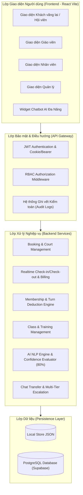
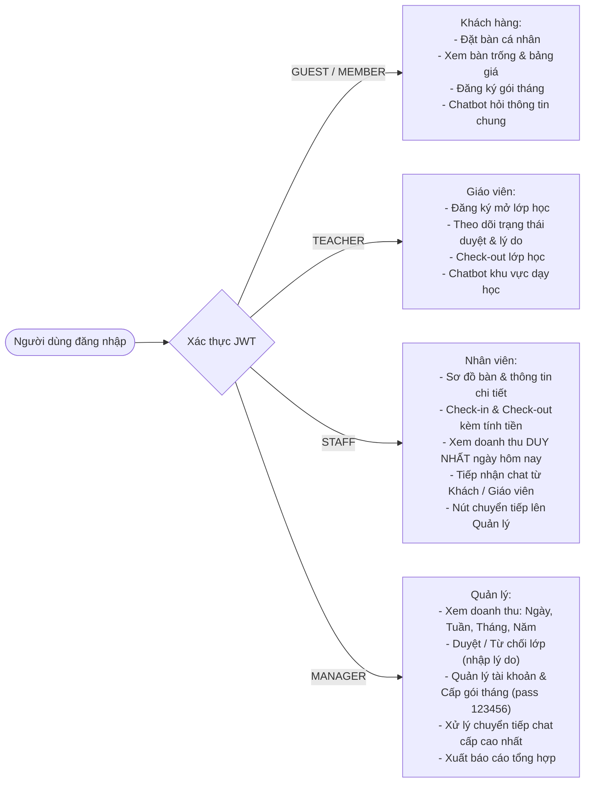
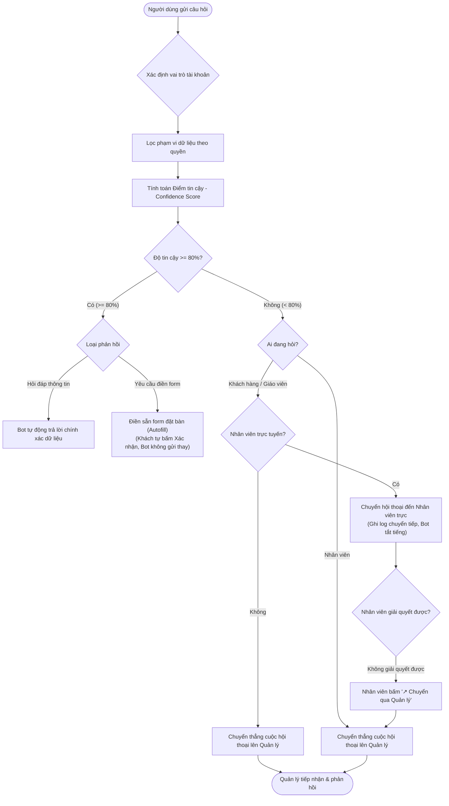
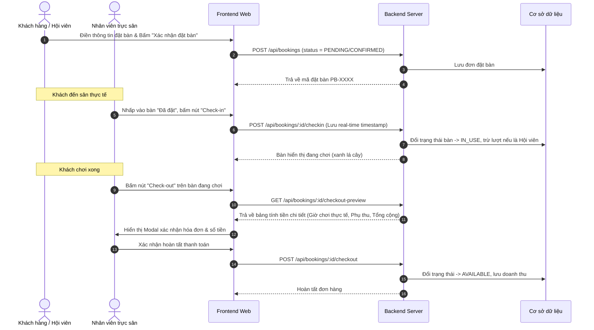

# TÀI LIỆU ĐẶC TẢ CHỨC NĂNG, KIẾN TRÚC HỆ THỐNG VÀ BÁO CÁO CÁC VẤN ĐỀ ĐÃ TRIỂN KHAI / FIX
**HỆ THỐNG QUẢN LÝ SÂN BÓNG BÀN THÔNG MINH - PINGPONGBROS**

---

## MỤC LỤC
1. [TỔNG QUAN HỆ THỐNG](#1-tổng-quan-hệ-thống)
2. [CÁC SƠ ĐỒ HỆ THỐNG CẦN THIẾT (SYSTEM DIAGRAMS)](#2-các-sơ-đồ-hệ-thống-cần-thiết)
   - 2.1. Sơ đồ kiến trúc tổng thể (System Architecture)
   - 2.2. Sơ đồ phân quyền truy cập (RBAC Matrix)
   - 2.3. Sơ đồ luồng Chatbot thông minh & Ngưỡng tin cậy (AI & Escalation Flow)
   - 2.4. Sơ đồ quy trình Đặt bàn, Check-in & Check-out tính cước
   - 2.5. Sơ đồ vòng đời Hội viên & Quy tắc trừ lượt (Membership Lifecycle)
3. [CHI TIẾT CHỨC NĂNG HỆ THỐNG THEO VAI TRÒ (RBAC FEATURES)](#3-chi-tiết-chức-năng-hệ-thống-theo-vai-trò)
   - 3.1. Khách vãng lai (Guest)
   - 3.2. Khách tháng / Hội viên (Member)
   - 3.3. Giáo viên / Huấn luyện viên (Teacher)
   - 3.4. Nhân viên trực sân (Staff)
   - 3.5. Quản lý / Quản trị viên (Manager)
4. [CHI TIẾT CÁC VẤN ĐỀ ĐÃ TRIỂN KHAI VÀ NÂNG CẤP](#4-chi-tiết-các-vấn-đề-đã-triển-khai-và-nâng-cấp)
5. [CHI TIẾT TẤT CẢ CÁC VẤN ĐỀ ĐÃ SỬA ĐỔI / FIX (BUG FIXES & IMPROVEMENTS)](#5-chi-tiết-tất-cả-các-vấn-đề-đã-sửa-đổi--fix)
6. [HƯỚNG DẪN KHỞI CHẠY VÀ VẬN HÀNH (DEPLOYMENT & EXECUTION)](#6-hướng-dẫn-khởi-chạy-và-vận-hành)

---

## 1. TỔNG QUAN HỆ THỐNG

**PingPongBros** là nền tảng quản lý câu lạc bộ bóng bàn hiện đại, tích hợp công nghệ trợ lý ảo AI thông minh, hỗ trợ đa vai trò người dùng nhằm tự động hóa quy trình đặt bàn, check-in/check-out tính cước theo thời gian thực, quản lý hội viên tháng, quản lý lớp đào tạo và giám sát doanh thu minh bạch.

### 1.1. Công nghệ sử dụng
- **Frontend**: React 18, TypeScript, TailwindCSS, Lucide React, Vite.
- **Backend**: Node.js, Express, TypeScript, Scrypt Password Hashing, JWT Authentication.
- **Lưu trữ & Dữ liệu**:
  - Tầng 1: File Storage (`store.json`) hỗ trợ sao lưu, khôi phục và hoạt động linh hoạt ngay tại local.
  - Tầng 2: PostgreSQL trên Supabase quản lý qua Prisma ORM.
- **Hạ tầng triển khai**: Cấu hình `render.yaml` triển khai 1-click lên Render Cloud (hỗ trợ phục vụ Fullstack Single-Port).

---

## 2. CÁC SƠ ĐỒ HỆ THỐNG CẦN THIẾT

### 2.1. Sơ đồ Kiến trúc Tổng thể Hệ thống (Architecture Diagram)



---

### 2.2. Sơ đồ Phân quyền Truy cập (RBAC Matrix)



---

### 2.3. Sơ đồ Luồng Chatbot Thông Minh & Ngưỡng Tin Cậy 80% (AI Escalation Flow)



---

### 2.4. Sơ đồ Chu trình Đặt bàn, Check-in & Check-out Tính Cước



---

### 2.5. Sơ đồ Vòng đời Hội viên & Quy tắc Trừ Lượt (Membership Lifecycle)

```mermaid
stateDiagram-v2
    [*] --> Guest: Khách vãng lai (Mặc định)
    Guest --> RegisteredMember: Mua gói tháng (1, 3, 6 tháng) tại Quầy/Web
    note right of RegisteredMember
        - Nâng cấp giữ nguyên UserID, SĐT, Email
        - Giữ nguyên lịch sử đơn & chat
        - Kích hoạt mustChangePassword nếu tạo mới
    end note
    
    RegisteredMember --> FirstLoginChange: Đăng nhập mật khẩu mặc định (123456)
    FirstLoginChange --> ActiveMember: Bắt buộc đổi mật khẩu mới thành công
    
    state ActiveMember {
        [*] --> CheckIn
        CheckIn --> PlayDuration: Đang chơi thực tế
        PlayDuration --> DeductRules: Check-out
        state DeductRules {
            LessThan2Hours: Thời gian chơi <= 2 giờ
            MoreThan2Hours: Thời gian chơi > 2 giờ
        }
        LessThan2Hours --> Minus1: Trừ 1 lượt
        MoreThan2Hours --> Minus2: Trừ 2 lượt
    }

    ActiveMember --> ZeroTurns: Số lượt về 0
    note right of ZeroTurns
        Khách tháng 0 lượt:
        Vẫn được đặt bàn như khách vãng lai,
        tính phí theo biểu giá thông thường.
    end note
    ZeroTurns --> ActiveMember: Mua thêm gói / gia hạn
    ActiveMember --> Expired: Hết thời hạn gói (30/90/180 ngày)
    Expired --> Guest: Quay về khách vãng lai (Giữ nguyên toàn bộ dữ liệu lịch sử)
```

---

## 3. CHI TIẾT CHỨC NĂNG HỆ THỐNG THEO VAI TRÒ

### 3.1. Khách vãng lai (`GUEST`)
1. **Tìm kiếm & Đặt bàn trực tuyến**:
   - Tra cứu trực quan danh sách bàn (Bàn VIP, Bàn Tiêu chuẩn), loại sân, giờ hoạt động.
   - Hỗ trợ chọn ngày, giờ bắt đầu, thời lượng chơi (1h, 1.5h, 2h, ...).
   - Tự động kiểm tra trùng lịch đặt sân.
2. **Tham khảo Gói Hội Viên Tháng**:
   - Menu được tích hợp trực tiếp và tinh gọn vào mục **"Sân"**.
   - Bảng so sánh 3 gói cước rõ ràng:
     - Gói 1 tháng: 449.000đ (30 lượt / 30 ngày) ~ 14.967đ/lượt 2 giờ.
     - Gói 3 tháng: 1.149.000đ (90 lượt / 90 ngày) ~ 12.767đ/lượt 2 giờ.
     - Gói 6 tháng: 1.999.000đ (180 lượt / 180 ngày) ~ 11.106đ/lượt 2 giờ (Tiết kiệm nhất).
     - Quyền lợi đặc biệt: Được đặt sân của khu vực học sau 19h00.
3. **Thông báo nhắc hẹn tự động**:
   - Hệ thống phát cảnh báo/thông báo trước **30 phút** khi đến giờ đặt bàn.
4. **Chatbot AI tư vấn**:
   - Hỗ trợ trả lời bàn trống, giá theo giờ, giờ mở cửa, thông tin gói hội viên.
   - Hỗ trợ trích xuất thông tin điền form đặt bàn. Không cho phép xem doanh thu hoặc thông tin quản trị.

---

### 3.2. Khách tháng / Hội viên (`MEMBER`)
1. **Đầy đủ quyền của Khách vãng lai**, kèm các đặc quyền:
   - Sử dụng thẻ hội viên theo số lượt đã đăng ký.
   - Đặt sân tại khu vực đào tạo sau 19h00 mỗi ngày.
2. **Cơ chế trừ lượt minh bạch**:
   - Chơi $\le 2$ giờ: Trừ **1 lượt**.
   - Chơi $> 2$ giờ: Trừ **2 lượt** (hoặc thanh toán phụ thu theo giờ nếu không đủ lượt).
   - Khi còn **0 lượt**: Khách vẫn được đặt bàn bình thường, hệ thống tự động tính phí như khách vãng lai mà không bị gián đoạn trải nghiệm.
3. **Đổi mật khẩu lần đầu đăng nhập bắt buộc**:
   - Khi tài khoản được nhân viên/quản lý cấp tại quầy với mật khẩu mặc định `123456`, trạng thái `mustChangePassword` kích hoạt.
   - Sau khi đăng nhập, hệ thống bắt buộc đổi mật khẩu mới trước khi truy cập bất kỳ tính năng nào. Đổi xong sẽ giải phóng trạng thái này vĩnh viễn.

---

### 3.3. Giáo viên / Huấn luyện viên (`TEACHER`)
1. **Đăng ký mở lớp đào tạo**:
   - Điền thông tin khóa học, lịch dạy, số lượng học viên và phòng học.
   - Gửi yêu cầu lên ban quản lý với trạng thái ban đầu: **"Chờ duyệt"**.
2. **Theo dõi trạng thái & Nhận thông báo**:
   - **Đã duyệt**: Khi quản lý duyệt, trạng thái chuyển xanh, mở lịch giảng dạy chính thức.
   - **Từ chối**: Khi bị từ chối, hệ thống hiển thị huy hiệu đỏ kèm **lý do từ chối cụ thể** do Quản lý nhập.
3. **Chức năng Check-out lớp học**:
   - Giáo viên có quyền tự bấm Check-out khi buổi học hoàn tất.
4. **Bảo mật & Quyền riêng tư AI**:
   - Đã loại bỏ hoàn toàn tab "Nhật ký AI" khỏi thanh điều hướng của giáo viên.
   - Chatbot chỉ trả lời về số bàn trống khu dạy học, giá buổi dạy (250.000đ/buổi), giờ mở cửa khu dạy (06:00 - 19:00). Cấm xem doanh thu CLB.

---

### 3.4. Nhân viên trực sân (`STAFF`)
1. **Quản lý sơ đồ bàn thời gian thực (Real-time Table Management)**:
   - Màu sắc trạng thái bàn trực quan: Xanh dương (Trống), Vàng (Đã đặt), Xanh lá (Đang chơi), Đỏ (Bảo trì).
   - Nhấp vào bàn hiển thị modal thông tin toàn diện: Tên khách, SĐT, loại khách, ngày/giờ đặt, số người chơi, số bàn.
2. **Quy trình Check-in & Check-out tại quầy**:
   - Bàn "Đã đặt" $\rightarrow$ Hiển thị nút **Check-in** (Lưu thời gian thực tế lúc khách vào).
   - Bàn "Đang chơi" $\rightarrow$ Hiển thị nút **Check-out**.
   - **Modal Preview Thanh toán**: Trước khi xác nhận hoàn tất check-out cho khách, hệ thống hiển thị popup chi tiết số giờ đã chơi thực tế, giá cước, phụ thu vượt giờ, số lượt hội viên trừ đi và **tổng tiền phải thu**.
3. **Giới hạn quyền xem Doanh thu nghiêm ngặt (Data Privacy)**:
   - Nhân viên **CHỈ ĐƯỢC XEM DOANH THU TRONG NGÀY HÔM NAY**.
   - Backend chặn hoàn toàn mọi truy vấn doanh thu tuần, tháng, quý, năm đối với vai trò nhân viên.
4. **Tiếp nhận & Xử lý Chuyển tiếp Hội thoại**:
   - Tiếp nhận cuộc trò chuyện mà Chatbot không đạt độ tin cậy ($\ge 80\%$) từ Khách hàng và Giáo viên.
   - Nút **"↗ Chuyển qua Quản lý"**: Khi nhân viên không đủ thẩm quyền xử lý, bấm nút này để leo thang chuyển tiếp lên Quản lý cấp cao.

---

### 3.5. Quản lý / Quản trị viên (`MANAGER`)
1. **Toàn quyền Quản trị & Điều hành**:
   - Sở hữu tất cả quyền hạn của Nhân viên.
   - Check-in và Check-out lớp học của Giáo viên.
2. **Báo cáo & Phân tích Doanh thu Đa chiều**:
   - Xem biểu đồ doanh thu theo Ngày, **Tuần**, **Tháng**, Quý, Năm và Toàn thời gian.
   - Phân tích mật độ khung giờ cao điểm (AI Peak Hour Density) dựa trên dữ liệu thực tế.
   - Xuất file báo cáo thống kê đơn hàng và hội viên.
3. **Phê duyệt Lớp học có kiểm soát**:
   - Duyệt lớp học chỉ với 1 click.
   - Khi từ chối bắt buộc phải nhập lý do giải trình trong modal popup để gửi phản hồi cho Giáo viên.
4. **Quản lý Tài khoản & Hội viên**:
   - Cấp tài khoản nhân viên và tài khoản khách tháng mới.
   - Mật khẩu mặc định tự động gán `123456`, mã hóa qua hàm băm Scrypt kèm Salt trước khi lưu vào DB.
   - Bật cờ `mustChangePassword = true`.
5. **Tiếp nhận Hội thoại Chuyển tiếp Cấp cao**:
   - Nhận thông báo khi có hội thoại từ Nhân viên chuyển lên hoặc khi ca trực không có nhân viên online.

---

## 4. CHI TIẾT CÁC VẤN ĐỀ ĐÃ TRIỂN KHAI VÀ NÂNG CẤP

| STT | Hạng mục triển khai | Chi tiết kỹ thuật | Vị trí file mã nguồn |
| :--- | :--- | :--- | :--- |
| 1 | **Xác thực Scrypt + JWT** | Băm mật khẩu bằng hàm Scrypt bảo mật chuẩn công nghiệp; cấp phát JWT token có thời hạn; kiểm soát phân quyền qua middleware `authenticateToken`. | `backend/src/services/storage.ts`, `backend/src/app.ts` |
| 2 | **Thời gian thực (Real-time Clock)** | Đồng bộ 100% thời gian thực của máy chủ và trình duyệt người dùng; loại bỏ toàn bộ switch giả lập demo clock để đảm bảo tính xác thực khi check-in. | `frontend/src/context/TimeContext.tsx` |
| 3 | **Mật độ giờ cao điểm AI** | Thuật toán quét toàn bộ đơn đặt bàn và lịch lớp học trong ngày để tính tỷ lệ lấp đầy bàn theo từng khung giờ (06:00 - 23:00). | `backend/src/app.ts` |
| 4 | **Đa tầng Lưu trữ (Dual Persistence)** | Hỗ trợ lưu trữ song song Supabase PostgreSQL (Prisma) và `store.json` tự động sao lưu. | `backend/src/services/storage.ts`, `backend/prisma/` |
| 5 | **Cấu hình Render 1-Click** | Thiết lập file `render.yaml` và `package.json` gốc, phục vụ frontend build tĩnh trực tiếp từ backend trên một cổng duy nhất. | `render.yaml`, `backend/src/app.ts` |

---

## 5. CHI TIẾT TẤT CẢ CÁC VẤN ĐỀ ĐÃ SỬA ĐỔI / FIX (BUG FIXES)

### Vấn đề 1: Bổ sung Trạng thái Duyệt & Lý do Từ chối Lớp học cho Giáo viên
- **Hiện trạng cũ**: Giáo viên gửi yêu cầu tạo lớp nhưng không biết quản lý đã duyệt hay chưa; nếu bị từ chối thì không rõ nguyên nhân.
- **Giải pháp đã fix**:
  - Thêm thuộc tính `status: 'PENDING' | 'APPROVED' | 'REJECTED'` và `rejectionReason: string` trong cơ sở dữ liệu.
  - Trên giao diện Quản lý: Thêm Modal bắt buộc nhập lý do khi nhấn "Từ chối".
  - Trên giao diện Giáo viên: Hiển thị badge trạng thái màu sắc kèm box thông báo lý do chi tiết khi bị từ chối.
  - Commit: `f138546`, `1e1d670`.

### Vấn đề 2: Điều chỉnh Menu Khách vãng lai & Tích hợp 3 Gói tháng vào tab "Sân"
- **Hiện trạng cũ**: Thanh menu có tab "Gói tháng" riêng lẻ gây phân tán trải nghiệm; thông tin gói tháng chưa đầy đủ.
- **Giải pháp đã fix**:
  - Gỡ bỏ mục "Gói tháng" khỏi Navbar chính của khách.
  - Tích hợp khu vực giới thiệu 3 gói tháng (1 tháng, 3 tháng, 6 tháng) ngay tại trang `/courts` với thiết kế dạng thẻ ưu đãi nổi bật.
  - Bổ sung thông báo nhắc nhở đặt bàn trước 30 phút trên giao diện.
  - Commit: `c03da85`.

### Vấn đề 3: Doanh thu Tuần & Tháng cho Quản lý
- **Hiện trạng cũ**: Trang Quản lý chỉ hiển thị thống kê ngày, thiếu xem doanh thu theo tuần và tháng.
- **Giải pháp đã fix**:
  - Thêm các hàm lọc doanh thu theo `week` (7 ngày gần nhất) và `month` (tháng hiện tại) trên backend.
  - Bổ sung giao diện thẻ thống kê doanh thu tuần và tháng trên dashboard Quản lý.
  - Commit: `1e1d670`.

### Vấn đề 4: Check-in/Check-out Thời Gian Thực & Modal Xem trước Thanh toán
- **Hiện trạng cũ**: Thao tác check-out chưa hiển thị số tiền thanh toán trước khi xác nhận.
- **Giải pháp đã fix**:
  - Thêm endpoint tính cước trước `GET /api/bookings/:id/checkout-preview`.
  - Hiển thị Modal chi tiết bao gồm: Tên khách, số bàn, thời gian vào - ra thực tế, thời lượng chơi, đơn giá, phụ thu quá giờ và tổng tiền phải thu.
  - Commit: `a7c65be`.

### Vấn đề 5: Hiển thị Thông tin Chi tiết Bàn
- **Hiện trạng cũ**: Nhấp vào bàn chưa hiện rõ đầy đủ số lượng người chơi và chi tiết khách hàng.
- **Giải pháp đã fix**:
  - Cập nhật modal thông tin bàn hiển thị chi tiết: Họ tên khách, SĐT, loại tài khoản, thời gian đặt, số lượng người chơi, số hiệu bàn.
  - Phân quyền chỉ cho phép Nhân viên và Quản lý thực hiện.
  - Commit: `a7c65be`.

### Vấn đề 6: Quy tắc Trừ Lượt Khách Tháng & Chính Sách 0 Lượt
- **Hiện trạng cũ**: Chưa xử lý việc trừ 2 lượt khi chơi quá 2 tiếng; khách 0 lượt bị khóa đặt bàn.
- **Giải pháp đã fix**:
  - Khi check-in: thời lượng $\le 2$ giờ trừ 1 lượt, $> 2$ giờ trừ 2 lượt.
  - Khi còn 0 lượt: Khách vẫn được phép đặt bàn bình thường, hệ thống tự động tính tiền theo biểu giá khách vãng lai.
  - Commit: `6a13548`.

### Vấn đề 7: Xóa Nhật ký AI ở vai trò Giáo viên & Bổ sung Check-out Lớp học
- **Hiện trạng cũ**: Giáo viên thấy tab "Nhật ký AI" (thông tin nội bộ) và không tự check-out được cho lớp của mình.
- **Giải pháp đã fix**:
  - Ẩn hoàn toàn tab "Nhật ký AI" đối với vai trò Giáo viên.
  - Bổ sung nút Check-out lớp học trực tiếp trong danh sách lớp học của Giáo viên.
  - Commit: `27f0bfd`.

### Vấn đề 8: Đổi Mật Khẩu Lần Đầu Đăng Nhập Bắt Buộc
- **Hiện trạng cũ**: Tài khoản tạo mới dùng mật khẩu mặc định `123456` mà không bắt buộc đổi mật khẩu.
- **Giải pháp đã fix**:
  - Thêm cờ `mustChangePassword: true` khi tạo tài khoản khách tháng mới.
  - Chặn sử dụng các chức năng chính nếu chưa đổi mật khẩu; hiển thị modal bắt buộc đổi mật khẩu ngay sau khi đăng nhập.
  - Commit: `c44e85a`.

### Vấn đề 9: Chuyển đổi Khách vãng lai thành Khách tháng Không sinh Tài khoản Mới
- **Hiện trạng cũ**: Khi mua gói tháng tại quầy hoặc online có thể bị tạo bản ghi khách hàng trùng lặp.
- **Giải pháp đã fix**:
  - Tìm kiếm người dùng theo Email/SĐT đã có trong hệ thống.
  - Nếu đã tồn tại tài khoản: cập nhật `role: 'MEMBER'`, giữ nguyên 100% `id`, thông tin cá nhân, lịch sử đơn hàng, lịch sử chat, điểm tích lũy.
  - Bảo vệ tuyệt đối không ghi đè tài khoản của Staff/Manager.
  - Commit: `c44e85a`.

### Vấn đề 10: Phân Quyền Chatbot Theo Vai Trò, Ngưỡng Tin Cậy 80% & Chuyển Tiếp Đa Cấp
- **Hiện trạng cũ**: Chatbot chưa kiểm soát chặt độ tin cậy; chuyển tiếp chưa phân tầng giữa Nhân viên và Quản lý.
- **Giải pháp đã fix**:
  - **Ngưỡng 80%**: Chỉ khi NLP xác định ý định và độ tin cậy $\ge 80\%$ thì Chatbot mới tự động phản hồi.
  - **Giới hạn hành vi**: Chatbot chỉ Autofill form đặt bàn, người dùng bắt buộc tự nhấn nút "Xác nhận đặt bàn".
  - **Phân tầng câu hỏi theo vai trò**:
    - Khách: Bàn trống, giá theo giờ, giờ mở cửa, giá gói tháng, autofill form.
    - Giáo viên: Bàn trống khu dạy học, giá buổi dạy (250k), giờ mở cửa khu dạy (06:00 - 19:00).
    - Nhân viên: Doanh thu ngày hôm nay (cấm tuần/tháng), bàn trống, autofill form.
    - Quản lý: Xem tất cả doanh thu ngày/tuần/tháng/toàn thời gian.
  - **Chuyển tiếp đa cấp**:
    - Khách/Giáo viên $< 80\% \rightarrow$ Chuyển Nhân viên trực. Nếu không có nhân viên trực $\rightarrow$ Chuyển Quản lý.
    - Nhân viên hỏi bot $< 80\% \rightarrow$ Chuyển thẳng Quản lý.
    - Thêm nút **"↗ Chuyển qua Quản lý"** trên giao diện hỗ trợ của Nhân viên để chuyển ca khó lên Quản lý.
    - Sau khi chuyển tiếp, Chatbot tự động **Mute** (tắt tiếng).
  - Commit: `5c9510b`, `36fd174`, `f5855bb`, `644467c`, `51fa0dd`.

---

## 6. HƯỚNG DẪN KHỞI CHẠY VÀ VẬN HÀNH

### 6.1. Khởi chạy dưới Local (Development)

1. **Khởi chạy Backend Server**:
   ```bash
   cd qlqtkd/backend
   npm install
   npm run build
   npm start
   # Server lắng nghe tại cổng http://localhost:5000
   ```

2. **Khởi chạy Frontend Web Client**:
   ```bash
   cd qlqtkd/frontend
   npm install
   npm run dev
   # Giao diện truy cập tại http://localhost:5173
   ```

### 6.2. Kiểm thử Build Sản phẩm (Production Build)
```bash
# Kiểm tra TypeScript và Build Backend
cd qlqtkd/backend && npm run build

# Kiểm tra TypeScript và Build Frontend
cd qlqtkd/frontend && npm run build
```

### 6.3. Tài Khoản Thử Nghiệm Mặc Định (Demo Accounts)

| Vai trò (Role) | Email | Mật khẩu mặc định | Ghi chú quyền hạn |
| :--- | :--- | :--- | :--- |
| **Quản lý (Manager)** | `admin@pingpongbros.vn` | `123456` | Toàn quyền quản trị, doanh thu ngày/tuần/tháng, xử lý chat |
| **Nhân viên (Staff)** | `staff@pingpongbros.vn` | `123456` | Sơ đồ bàn, check-in/out, doanh thu DUY NHẤT hôm nay |
| **Giáo viên (Teacher)** | `teacher@pingpongbros.vn` | `123456` | Quản lý lớp dạy, xem trạng thái & lý do từ chối, check-out lớp |
| **Hội viên (Member)** | `member@pingpongbros.vn` | `123456` | Thẻ tháng, trừ lượt chơi, đặt sân khu học sau 19h |
| **Khách mới (First Login)** | Tạo mới từ Quản trị | `123456` | Bắt buộc đổi mật khẩu mới ở lần đăng nhập đầu tiên |

---

*Tài liệu được cập nhật tự động và đồng bộ với phiên bản mã nguồn mới nhất trên hệ thống quản lý mã nguồn.*

